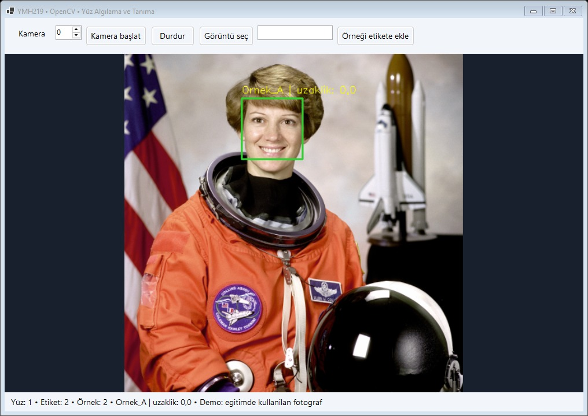
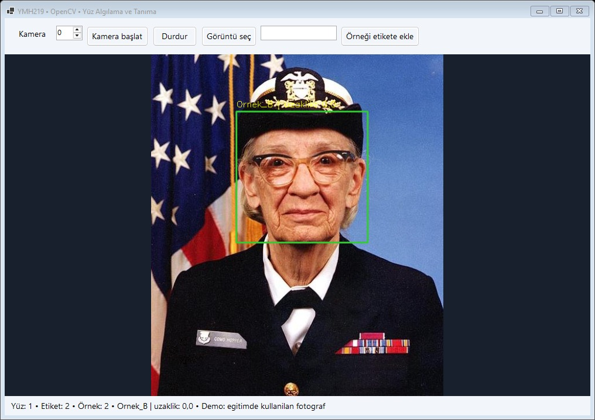

# OpenCV ile Yüz Algılama ve Tanıma

YMH219 Nesne Tabanlı Programlama ek uygulama ödevi. C# ile geliştirilen Windows Forms masaüstü uygulaması.

## Teknolojiler
Windows x64, C#, .NET 10, Windows Forms. OpenCvSharp4.Windows 4.13.0.20260627 — https://www.nuget.org/packages/OpenCvSharp4.Windows/4.13.0.20260627; Haar Cascade + LBPH

## Kurulum ve çalıştırma
1. .NET 10 SDK ve .NET 10 destekli Visual Studio (.NET masaüstü geliştirme iş yükü) kurun.
2. `FaceRecognition.sln` dosyasını açın, NuGet paketlerini geri yükleyin ve F5 ile çalıştırın.
3. Alternatif: bu klasörde `dotnet run --project FaceRecognition.csproj` çalıştırın.
4. Derleme kontrolü: `dotnet build FaceRecognition.csproj -c Release`.

## Temel özellikler ve kullanım
Kamera başlat veya Görüntü seç ile yüz içeren bir görüntü açın. Tek yüz içeren örneğe etiket verip Örneği etikete ekle seçin. En az iki farklı gönüllü etiketinden birkaç örnek ekleyin; ardından eğitimde kullanılmayan fotoğraflarla tahmini deneyin. Alternatif: kendi yüzünüzün farklı örneklerini iki yerel örnek grubu olarak etiketleyin.

## Ekran görüntüleri

İki ekran, internetten alınmış kamu malı örnek fotoğraflarla çalışan uygulamadan alınmıştır. Fotoğraflar eğitimde de kullanıldığı için bunlar bağımsız doğruluk testi değildir. [Fotoğraf kaynakları ve tekrar deneme adımları](docs/demo/README.md). Bu demo, föydeki gönüllü yerel örnek koşulunu tek başına karşılamaz.

## Sınırlamalar ve geliştirme notları
Etiket ve eğitim örnekleri bellektedir, kapanınca silinir. Kullanıcının kamera görüntüleri otomatik kaydedilmez; depoda yalnızca kaynakları belirtilmiş demo fotoğrafları bulunur. LBPH uzaklığı olasılık/yüzde değildir; daha düşük değer daha yakın eşleşmedir. 80 eşiğinin üstünde Bilinmiyor döner. Bu küçük yerel demonstrasyon gerçek kimlik doğrulama sistemi değildir. Windows x64 ve gerekirse Microsoft Visual C++ 2015–2022 x64 runtime gerekir.

Arayüz MainForm, başlangıç Program, ortak görsel yardımcılar Ui sınıfındadır. Formların Dispose metotları kullanılan kaynakları temizler.

## Öğrenci bilgileri
- Ad soyad: **Talha Nuri Önder**
- Öğrenci numarası: **210541054**
